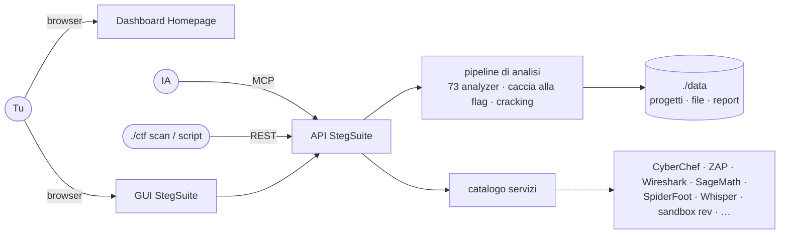
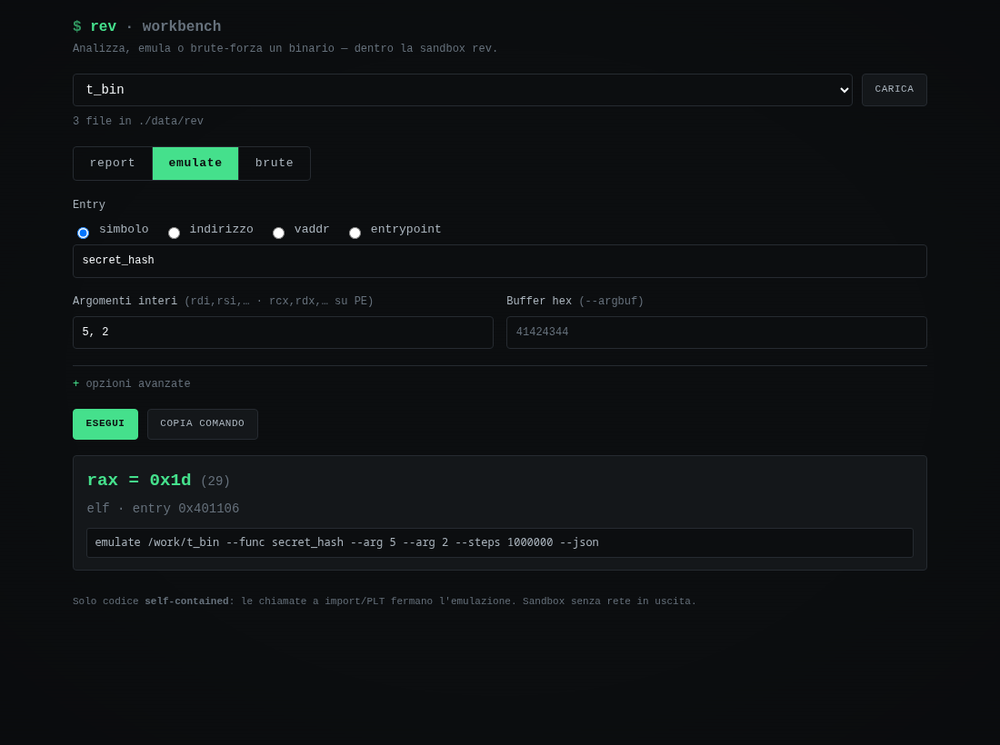

<h1 align="center">CTF Toolbox</h1>

<p align="center">
  Banco di lavoro self-hosted, tutto da browser, per <strong>risolvere le CTF</strong> —
  a mano, in automatico, o pilotato da un'IA.
  <br>
  Un <code>./ctf up</code>, una dashboard, ogni tool con interfaccia web.
</p>

<p align="center">
  <a href="README.md">🇬🇧 English</a> · <a href="README.it.md">🇮🇹 Italiano</a>
</p>

<p align="center">
  <a href="https://github.com/dexRand/ctf-docker/actions/workflows/ci.yml"></a>
  
  
  
  
</p>

---

**CTF Toolbox** è uno stack Docker Compose con i tool che si usano davvero in
una Capture The Flag — steganalisi, forensics, encoding/crypto, web, OSINT,
reversing, cracking di password — ognuno con **interfaccia web**, dietro una
dashboard che li elenca per fase di lavoro.

Il cuore è **StegSuite**, un banco di analisi che prende i file della challenge,
esegue **73 analyzer** in modo ricorsivo, cerca la flag, cracca ciò che è
bloccato e ti dice **come** ci è arrivato. Lavora **per CTF**: crei l'evento,
carichi le sue challenge, lasci che l'**autosolver** risolva quelle facili e
continui sulle altre — da solo, o tramite un'**IA** collegata via **MCP**.

## Indice

- [Caratteristiche](#-caratteristiche) · [Avvio rapido](#-avvio-rapido) · [Come funziona](#-come-funziona)
- [Lavorare su una CTF](#-lavorare-su-una-ctf) · [IA (MCP)](#-ia-mcp) · [Tool](#-tool)
- [StegSuite](#-stegsuite) · [CLI](#%EF%B8%8F-cli) · [API](#-api) · [Configurazione](#%EF%B8%8F-configurazione)
- [Sicurezza](#-sicurezza) · [Test su CTF reali](#-test-su-ctf-reali)
- [Problemi comuni](#-problemi-comuni) · [Struttura](#-struttura) · [Contribuire](#-contribuire)

## ✨ Caratteristiche

- **Pronto all'avvio** — `./ctf up` crea `.env`, avvia il core, aspetta che
  StegSuite sia pronto e ti dice dove andare.
- **Una CTF = un progetto** — la CTF contiene le sue challenge e il formato
  flag; una flag in quel formato segna la challenge **risolta**; uno scoreboard le mostra tutte.
- **Autosolver** — analizza tutte le challenge aperte, poche alla volta.
- **73 analyzer** ricorsivi: metadati, stringhe/encoding/esolang, stego su
  immagini (LSB, steghide, outguess, zsteg…), OCR/QR, audio (spettrogramma,
  morse, DTMF, SSTV, LSB/livelli WAV), rete (tshark, TLS con chiavi/keylog,
  flussi, tunnel DNS), archivi/office/email/git, ELF.
- **Cracking integrato** — ZIP (ZipCrypto + AES via hashcat), PDF, steghide,
  known-plaintext (`bkcrack`), wordlist dalla più piccola alla più grande, regole e maschere.
- **Spiega la soluzione** — ogni flag ha la catena di file che porta a lei e
  l'output del tool che la mostra; report Markdown (EN/IT) e transcript per
  un'IA, per continuare a mano.
- **API-first** — tutto ciò che fa la GUI è un endpoint REST; la stessa
  superficie è un **server MCP** per le IA.
- **Isolato** — tutto su `127.0.0.1`, porte `19000+` da `.env`, tool pesanti
  dietro profili Compose, la sandbox di reversing non ha internet.

## 🚀 Avvio rapido

```bash
git clone https://github.com/dexRand/ctf-docker.git
cd ctf-docker
./ctf up
```

```text
[*] Attendo che StegSuite sia pronto.... ok

  Pronto. Da qui:
    Dashboard   http://localhost:19001/
    StegSuite   http://localhost:19014/     crea una CTF e trascina gli allegati
    API         http://localhost:19014/api/docs
    IA (MCP)    ./ctf mcp
```

Il primo avvio costruisce StegSuite una volta (qualche minuto). Aggiungi tool
con i profili, es. `./ctf up web rev` (ZAP + sandbox di reversing).
`./ctf urls` elenca tutto.

## 🧭 Come funziona



StegSuite percorre l'albero dei file nell'ordine di scoperta: per ogni file
esegue gli analyzer adatti (in base al tipo reale, non al nome), salva l'output,
ci cerca le flag, aggiunge i file estratti come figli e ricorre. In modalità
**auto** poi cracca i file bloccati con le wordlist piccole e analizza ciò che sbloccano.

## 🏁 Lavorare su una CTF

1. **Crea la CTF** nella home di StegSuite: nome + formato flag
   (`DUCTF{...}`, oppure una regex come `FLAG-[0-9a-f]{8}`).
2. **Aggiungi le challenge**: un upload (uno o più file) = una challenge, con
   categoria opzionale. Viene analizzata subito.
3. **Autosolve**: un clic analizza tutte le challenge aperte, 2 alla volta.
   Una flag nel formato della CTF segna la challenge ✓ risolta.
4. **Continua** su quelle aperte: la pagina della challenge mostra l'albero dei
   file, l'output di ogni tool, i file bloccati (scegli wordlist, regole,
   maschera o un plaintext noto), un terminale nella cartella del progetto, il
   grafo del percorso della flag, il report e il transcript per l'IA. Rilancia
   qualsiasi tool su qualsiasi file, anche con una password trovata.

Anche senza CTF, la home accetta file e li analizza come un singolo progetto
(`--auto` fa tutto, `--check` aspetta te prima di craccare).

## 🤖 IA (MCP)

StegSuite è un server [MCP](https://modelcontextprotocol.io) su
`/api/v1/mcp` (Streamable HTTP). Con Claude Code:

```bash
./ctf mcp      # stampa il comando esatto, es.
claude mcp add --transport http ctf http://127.0.0.1:19014/api/v1/mcp
```

L'IA ha 19 tool: creare/elencare CTF, scoreboard, aggiungere challenge (file da
URL o base64), autosolve, analizzare, stato, flag con il loro percorso, report,
transcript, leggere un file, eseguire analyzer su un file, file bloccati,
craccare, wordlist, modificare una challenge, e l'elenco degli altri servizi
del toolbox (`toolbox_services`) con URL e stato. Ciclo tipico:

```
create_ctf → add_challenge(start) → project_status … → get_flags
           ↘ nessuna flag: get_transcript → run_tools / crack / read_file
```

## 🧰 Tool

| Fase | Tool | URL | A cosa serve | Profilo |
| --- | --- | --- | --- | --- |
| Dashboard | Homepage | http://localhost:19001 | Tutti i tool per fase, con stato in tempo reale | core |
| Analisi | **StegSuite** | http://localhost:19014 | CTF/challenge, 73 analyzer, flag, cracking, report, REST + MCP | core |
| Analisi | **Terminale** | http://localhost:19022 | VS Code nel browser (code-server, tema della suite) su `./data/projects`: albero file, hex editor, viewer PDF/SQLite, sintassi asm/smali/solidity, terminali `stegsuite` (tutti i tool, `cdp <progetto>`) e `rev` (sandbox) · `` Ctrl+` `` terminale | core |
| Analisi | FileBrowser | http://localhost:19012 | Sfoglia `./data`: progetti, estratti, report | core |
| Crypto/Encoding | **CyberChef** | http://localhost:19002 | Base64, XOR, RSA, hash, JWT e molto altro | core |
| Web | **mitmproxy** | http://localhost:19003 | Intercetta e modifica HTTP(S) · proxy su `:19004` | core |
| Utility | IT-Tools | http://localhost:19011 | Encoder, convertitori, hash, regex | core |
| Recon | Dork generator | http://localhost:19019 | Dork curati + Google Hacking Database, da un target (niente scraping) | core |
| Web | **OWASP ZAP** | http://localhost:19005/zap | Scanner web con GUI nel browser · proxy su `:19006` · add-on extra | `web` |
| Recon | SpiderFoot | http://localhost:19007/spiderfoot/ | Automazione OSINT | `recon` |
| Crypto | SageMath | http://localhost:19010 | Notebook Jupyter per crypto e matematica | `crypto` |
| Forensics | Wireshark | http://localhost:19008 | Analisi pacchetti con GUI web | `forensics` |
| Cracking | Hashtopolis | http://localhost:19016 | hashcat distribuito (agent via voucher) | `crack` |
| Audio | **Whisper-WebUI** | http://localhost:19017 | Trascrizione con timestamp (SRT/VTT) | `audio` |
| Rev/Pwn | **sandbox rev** | http://localhost:19018 | Terminale web per ELF/PE/APK: Ghidra headless, radare2, gdb, strace/ltrace, upx, apktool, jadx, pwntools, qemu-user · senza internet | `rev` |
| Rev/Pwn | **rev workbench** | http://localhost:19020 | Workbench da browser: report automatico (`rev-report`), emulazione Unicorn + brute (`emulate`), esecuzione simbolica con angr | `rev` |

Ogni immagine upstream è fissata per digest (`tag@sha256:…`): una macchina nuova
esegue esattamente ciò che è stato testato; `python3 tools/pin_images.py` mostra le
build più nuove e `--write` le aggiorna. Tre immagini sono costruite in locale: StegSuite
(`app/Dockerfile`), ZAP con add-on extra (`zap/Dockerfile`) e la sandbox rev
(`rev/Dockerfile`).

## 🔬 StegSuite

| Area | Analyzer |
| --- | --- |
| Identificazione / metadati | `file`, `exiftool`, `identify`, `ffprobe`, `pdfinfo`, `pdfid` |
| Testo ed encoding | `strings`, `markup-text` (testo di SVG/HTML/XML), `xxd`/`hexyl`/`hexdump`, `decode` (base64/32/85, hex, binario, rot13, URL, bit alto, annidati), `blobs` (blocchi base64/hex → file/testo), `pdftotext`, `morse-text` |
| PDF e tastiere | `pdf` (cifrato → auto-crack), `pdf-images` (immagini incorporate → OCR), `usb-hid` (report HID → testo digitato) |
| Stego su testo ed esolang | `zero-width` (caratteri ZW, whitespace a due simboli, spazi finali), `whitespace` (interprete), `case-bits` (binario + Bacon), `homoglyph`, `chef` (ricette con quantità ignote), `sqlite` (testo nelle tabelle: history, cookie, dati app) |
| Stego su immagini | `zsteg`, `lsb-carve`, `lsb-bits` (LSB dei byte grezzi), `msb-bits` (piano MSB), `stepic`, `psimage`, `steghide`, `outguess`, `jsteg`, `openstego`, `png-chunks`, `png-idat` (IDAT zstd/deflate), `png-pixels`, `pixel-bytes` (pixel che sono un altro file, catene seguite), `bit-planes`, `channel-remap` (+ ricolorazione per indice di palette), `image-enhance` |
| Vision | `ocr` (tesseract, EN + fallback IT, denoise + correzioni O/0), `qr`, `gif-frames` (frame, differenze, bit nei ritardi) |
| Audio / radio | `spectrogram`, `waveform`, `wav-lsb`, `wav-levels`, `morse`, `dtmf`, `sstv` (Scottie S1/S2), `eas` (SAME/EAS + AFSK via multimon-ng) |
| Rete | `pcap` (protocolli, campi HTTP/DNS, commenti, flussi UDP/TCP ricomposti, base64 spezzato un token per pacchetto, testo nelle porte sorgente, tunnel DNS, tunnel DNS per server di destinazione, evil bit RFC 3514, oggetti HTTP, TLS con chiave o keylog TLS 1.3, HTTP/2) |
| Archivi e documenti | `7z`, `nested-archive`, `binwalk` (scan/estrazione), `foremost`, `office` (OOXML/ODF + macro), `eml`, `git` (storia, reflog, tutti gli oggetti), `disk` (sleuthkit: partizioni, fls/icat), `openssl` (`Salted__` + password dai sibling) |
| Windows | `evtx` (log eventi come testo, pezzi base64 riuniti nella flag), `sam` (hash locali + hashcat), `firefox-logins` (login salvati via libnss3), `cpassword` GPP decifrata (in `markup-text`) |
| Riparazione | `pngcheck`, `png-repair` (chunk), `image-repair` (header JPEG/BMP/GIF, prefisso spazzatura, altezza BMP), `byte-swap` (file con parole da 16/32 bit invertite) |
| Binari | `elf` (sezioni, info dinamiche, checksec), `readelf`, `objdump` |

**Caccia alla flag** — ogni output è scansionato in più viste (grezzo, UTF-16,
URL-decoded, senza spazi, un livello di base64/hex inline, XOR fra coppie di
stringhe) cercando i prefissi CTF comuni (`picoCTF`, `flag`, `CTF`, `HTB`,
`DUCTF`, `ictf`, `tjctf`, `lactf`, `SEKAI`, …), i gemelli rot13, le graffe
rovinate dall'OCR, il **formato della CTF** e un `FLAG_PATTERN` globale
opzionale. Duplicati, gemelli rot13 e frammenti di una flag più lunga diventano una sola flag.

**Cracking** — `fcrackzip`, hashcat (`zip2hashcat`, ZipCrypto + AES, regole,
maschere), `pdfcrack`, `stegseek`, `bkcrack` (known plaintext). Wordlist da
`./wordlists` (montata), upload (persistenti) e `rockyou.txt` completa
nell'immagine, dalla più piccola alla più grande. In modalità auto usa solo le
liste ≤ `AUTO_CRACK_MAX_MB` entro `AUTO_CRACK_BUDGET_S`, così un falso "bloccato"
non ferma la challenge. Un suggerimento di password in un file fratello (`psw: …`) e i metadati descrittivi della challenge (Title, Comment, Author… EXIF/XMP, chunk di testo PNG) vengono provati per primi, da soli.

**GUI** — tema terminale, EN/IT, albero dei file, output per tool con colori
ANSI, anteprime immagine/audio/video, log live (WebSocket), terminale integrato
(xterm.js), grafo del percorso della flag, report e transcript, responsive.

<p align="center">
  
</p>

## 🐞 Rev sandbox

Tre modi per entrare nella stessa sandbox isolata ELF/PE/APK (profilo `rev`):

- **terminale** (`:19018`) — shell web semplice con il menu dei tool (`menu`), senza internet
- **workbench** (`:19020`) — carichi un binario e parte `rev-report`; emuli una funzione con Unicorn (anche brute-force del primo argomento) o la risolvi con angr
- **VS Code** (`:19022`, `term`) — il profilo terminale `rev` fa `docker exec` in questa sandbox; pane e tab sono quelli di VS Code

<p align="center">
  
</p>

## ⌨️ CLI

```bash
./ctf up [profilo…]     # core (+ profili), aspetta che sia pronto
./ctf up-all            # tutti i profili (diversi GB di immagini)
./ctf down | status | logs <servizio> | list
./ctf urls              # ogni servizio e il suo URL (porte da .env)
./ctf open <servizio>   # apre nel browser (stegsuite, zap, rev, wireshark…)
./ctf mcp               # collega un'IA
./ctf pull <url>…       # scarica gli allegati di una challenge in ./data/pull
./ctf scan <file>…      # analizza con StegSuite e stampa le flag (exit 1 su errore)
./ctf reports           # sfoglia ./data con FileBrowser
./ctf dork [target]     # dork generator (--update sincronizza la GHDB)
./ctf geo <foto>…       # photo-geolocate: EXIF/GPS, posizione del sole, OCR, link mappe
./ctf test [-j 3]       # regressione + challenge CTF reali (vedi sotto)
./ctf ui-smoke          # smoke test della SPA con browser headless
```

## 🔌 API

OpenAPI/Swagger su **http://localhost:19014/api/docs**; la guida con gli esempi
è [`docs/API.md`](docs/API.md). In breve:

| | |
| --- | --- |
| CTF | `GET/POST /ctfs` · `GET/PATCH/DELETE /ctfs/{cid}` · `POST /ctfs/{cid}/challenges` · `POST/GET/DELETE /ctfs/{cid}/autosolve` |
| Challenge | `POST /projects` · `GET/PATCH/DELETE /projects/{pid}` · `POST /projects/{pid}/start|pause|resume|cancel` |
| Risultati | `/findings` · `/runs` · `/events` · `/flags` (catena + prova) · `/summary` · `/report?format=md|json&lang=en|it` · `/logs` · `/transcript` |
| Lavoro | `POST /projects/{pid}/files/{fid}/run` (rilancia tool, password opzionale) · `/locked` · `POST /crack` (in coda, per file) · `GET /cracks` · `DELETE /cracks/{id}` · `/wordlists` |
| Stateless | `GET /tools` · `POST /tools/{tool}` (un tool su un file) |
| Toolbox | `GET /services` (altri tool: URL + stato) · `POST /mcp` |

Un client stdlib è in [`tools/stegsuite_client.py`](tools/stegsuite_client.py).

## ⚙️ Configurazione

Tutto arriva da `.env` (creato da `.env.example` al primo avvio).

| Variabile | A cosa serve |
| --- | --- |
| `BIND_ADDR` | Interfaccia su cui sono pubblicate le porte — default `127.0.0.1` (solo locale) |
| `*_PORT` | Porta host di ogni servizio (19000+); link, dashboard e API le seguono |
| `STEGSUITE_API_KEY` | Chiave richiesta su API/MCP (header, cookie o `?key=`) |
| `FLAG_PATTERN` | Regex flag globale in più (il formato di una CTF si imposta sulla CTF) |
| `MAX_DEPTH`, `HEAVY_TOOLS`, `TOOL_WORKERS`, `MAX_UPLOAD_MB` | Profondità di ricorsione, tool pesanti in parallelo, analyzer in parallelo per file, limite upload |
| `AUTO_CRACK_MAX_MB`, `AUTO_CRACK_BUDGET_S`, `CRACK_BUDGET_S`, `HASHCAT_RULES` | Limiti e regole del cracking |
| `CRACK_WORKERS` | Crack manuali eseguiti insieme; gli altri aspettano nella coda di cracking |
| `OCR_LANGS`, `OCR_EXTRA_LANGS`, `OCR_MAX_DIM` | Lingue OCR e ridimensionamento |
| `RETENTION_DAYS`, `RATE_LIMIT_RPM`, `RATE_LIMIT_BURST` | Pulizia progetti vecchi, rate limit per IP |
| `MITMWEB_PASSWORD`, `HASHTOPOLIS_*`, `PUID`/`PGID`/`TZ` | Altri servizi |

Memoria: il core gira bene con ~4 GB liberi. I limiti `mem_limit` sommano
~6 GB per il core e ~25 GB con tutti i profili (whisper 6 GB, rev e StegSuite
4 GB ciascuno): avvia i profili quando servono.

## 🔒 Sicurezza

- **Locale di default**: ogni porta è pubblicata su `127.0.0.1` (`BIND_ADDR`).
  Diversi tool (ZAP, Wireshark, mitmweb, la dashboard col socket Docker) non
  hanno autenticazione forte: esponili solo su una rete di cui ti fidi.
- **File non fidati**: gli analyzer girano nel container StegSuite con timeout
  che terminano l'intero gruppo di processi; i repo git dagli archivi girano con
  la config neutralizzata; il report fa escape di tutto e tiene solo link http(s)/stessa origine.
- **Eseguire binari**: solo nella sandbox **rev** — rete interna senza uscita,
  `cap_drop: ALL` (+ `SYS_PTRACE`), `no-new-privileges`, limiti di pid/memoria.
- **API key** (opzionale) protegge REST, WebSocket e MCP; i segreti stanno in
  `.env` (ignorato da git) e StegSuite riceve solo le variabili che le servono.

## 🧪 Test su CTF reali

Ogni modifica è verificata su challenge vere, non solo con i test unitari:

```bash
app/tests/run_unit.sh          # 200+ test pytest dentro l'immagine StegSuite
./ctf test -j 3                # 33 casi fixture + 35 challenge reali + verifica writeup
./ctf test -j 3 --extra        # + altre 14 reali (picoCTF 2019–2025, TJCTF, LA CTF, ImaginaryCTF…)
./ctf test --only-new --gaps   # lacune note: il backlog delle tecniche da aggiungere
```

Le challenge reali arrivano da archivi pubblici e writeup (picoCTF,
OliCyber/ITS, SekaiCTF, DownUnderCTF, TJCTF, ImaginaryCTF, LA CTF, UIUCTF…)
con le flag documentate — vedi [`docs/CHALLENGES.md`](docs/CHALLENGES.md).
`--json-out` registra i tempi per challenge, per confrontare le prestazioni.

## 🩺 Problemi comuni

| Sintomo | Soluzione |
| --- | --- |
| `./ctf up` aspetta e StegSuite non risponde | `./ctf logs stegsuite`; la prima build richiede qualche minuto |
| Un tool risulta *down* in dashboard | il suo profilo non è avviato: `./ctf up <profilo>` |
| Porta già occupata | cambia quel `*_PORT` in `.env`; i link si adeguano da soli |
| `401` dalle API | è impostata `STEGSUITE_API_KEY`: la GUI la chiede una volta; gli script la leggono da `.env` |
| SageMath chiede un token | `./ctf logs sagemath` |
| Login di mitmweb | password `MITMWEB_PASSWORD` (default `mitm`) |
| Memoria esaurita | ferma i profili pesanti (`whisper`, `rev`, `forensics`), abbassa `HEAVY_TOOLS` |

## 📂 Struttura

```
compose.yaml          servizi (progetto "ctf"), profili, ancora x-base
ctf                   wrapper CLI
.env.example          porte e configurazione
app/                  StegSuite: backend/ (FastAPI), frontend/ (Vue 3), tests/, Dockerfile
  backend/analyzers/  un modulo per analyzer + util.py (funzioni condivise)
  backend/            pipeline, jobs, flaghunt, crackflow, report, ctfs, mcp_server, api/
config/               dashboard homepage, dork generator, filebrowser, whisper, zap
rev/                  immagine della sandbox di reversing (ttyd + Ghidra headless + tool) + rev-report/emulate/angr e il workbench web
zap/                  immagine ZAP con add-on extra
tools/                stegsuite_client, scan, check_consistency, dork, photo-geolocate
osint/                area OSINT separata (override compose, README proprio)
docs/                 API.md, ADDING-A-TOOL.md, CHALLENGES.md, screenshot
tasks/                piani e stato
```

## 🤝 Contribuire

- Nuovo analyzer: [`docs/ADDING-A-TOOL.md`](docs/ADDING-A-TOOL.md) — un modulo
  in `app/backend/analyzers/`, funzioni condivise da `util.py`, un test unitario
  e, se possibile, una challenge reale in `app/tests/real_challenges.py`.
- Nuovo servizio: aggiorna `compose.yaml`, `.env.example`, la dashboard
  (`config/homepage/services.yaml`), la tabella `SERVICES` in `ctf`, il catalogo
  in `app/backend/services.py` e questo README —
  `python3 tools/check_consistency.py` ti dice cosa manca (la CI lo esegue).
- Convenzioni e regole per gli agent: [`AGENTS.md`](AGENTS.md).

## 📄 Licenza

MIT — vedi [`LICENSE`](LICENSE). Le Agent Skills in `.opencode/skills/` vengono
da [`addyosmani/agent-skills`](https://github.com/addyosmani/agent-skills)
(MIT, vedi [`.opencode/ATTRIBUTION.md`](.opencode/ATTRIBUTION.md));
`third_party/zip2hashcat.py` mantiene la sua nota MIT.
