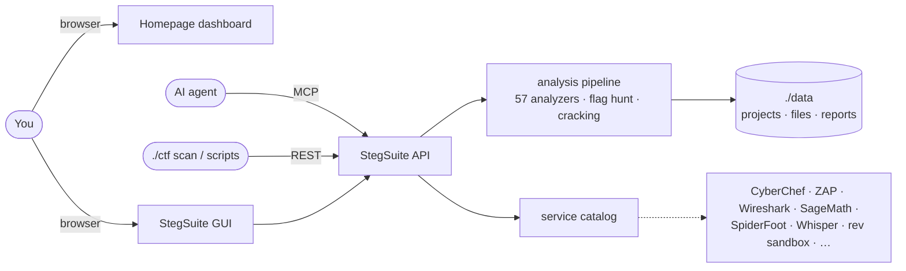
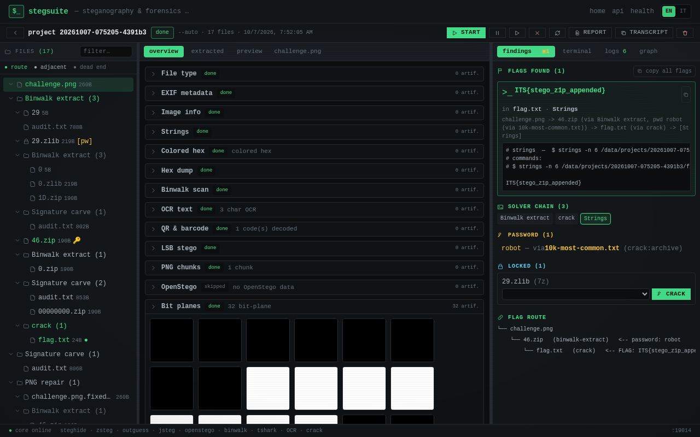

<h1 align="center">CTF Toolbox</h1>

<p align="center">
  Self-hosted, browser-based workbench for <strong>solving CTFs</strong> —
  by hand, automatically, or driven by an AI agent.
  <br>
  One <code>./ctf up</code>, one dashboard, every tool with a web GUI.
</p>

<p align="center">
  <a href="README.md">🇬🇧 English</a> · <a href="README.it.md">🇮🇹 Italiano</a>
</p>

<p align="center">
  <a href="https://github.com/dexRand/ctf-docker/actions/workflows/ci.yml"></a>
  
  
  
  
</p>

---

**CTF Toolbox** is a Docker Compose stack with the tools people actually use
during a Capture The Flag — steganalysis, forensics, encoding/crypto, web,
OSINT, reversing, password cracking — each with a **web interface**, behind a
dashboard that lists them by phase of work.

At its core is **StegSuite**, an analysis workbench that takes the challenge
files, runs **57 analyzers** recursively, hunts the flag, cracks what is locked
and tells you **how** it got there. It works **per CTF**: create the event, drop
in its challenges, let the **autosolver** take the easy ones and keep working on
the rest — yourself, or through an **AI agent** connected over **MCP**.

## Contents

- [Features](#-features) · [Quick start](#-quick-start) · [How it works](#-how-it-works)
- [Working on a CTF](#-working-on-a-ctf) · [AI agents (MCP)](#-ai-agents-mcp) · [Tools](#-tools)
- [StegSuite](#-stegsuite) · [CLI](#%EF%B8%8F-cli) · [API](#-api) · [Configuration](#%EF%B8%8F-configuration)
- [Security model](#-security-model) · [Testing against real CTFs](#-testing-against-real-ctfs)
- [Troubleshooting](#-troubleshooting) · [Project layout](#-project-layout) · [Contributing](#-contributing)

## ✨ Features

- **Ready on start** — `./ctf up` creates `.env`, starts the core, waits until
  StegSuite is healthy and prints where to go.
- **One CTF = one project** — a CTF holds its challenges and its flag format;
  a flag in that format marks the challenge **solved**; a scoreboard shows them all.
- **Autosolver** — analyzes every unsolved challenge, a few at a time.
- **57 analyzers**, recursive: metadata, strings/encodings/esolangs, image stego
  (LSB, steghide, outguess, zsteg…), OCR/QR, audio (spectrogram, morse, DTMF,
  SSTV, WAV LSB/levels), network (tshark, TLS with keys/keylog, streams, DNS
  tunnels), archives/office/email/git, ELF.
- **Cracking built in** — ZIP (ZipCrypto + AES via hashcat), PDF, steghide,
  known-plaintext (`bkcrack`), wordlists smallest → largest, rules and masks.
- **Explains the solution** — every flag comes with the chain of files that led
  to it and the tool output that shows it; Markdown report (EN/IT) and an AI
  transcript to continue by hand.
- **API-first** — everything the GUI does is a REST endpoint; the same surface is
  an **MCP server** for AI agents.
- **Isolated** — everything on `127.0.0.1`, ports `19000+` from `.env`, heavy
  tools behind Compose profiles, the reversing sandbox has no internet.

## 🚀 Quick start

```bash
git clone https://github.com/dexRand/ctf-docker.git
cd ctf-docker
./ctf up
```

```text
[*] Attendo che StegSuite sia pronto.... ok

  Pronto. Da qui:
    Dashboard   http://localhost:19001/
    StegSuite   http://localhost:19014/     crea una CTF e trascina gli allegati
    API         http://localhost:19014/api/docs
    IA (MCP)    ./ctf mcp
```

The first start builds StegSuite once (a few minutes). Add tools with profiles,
e.g. `./ctf up web rev` (ZAP + reversing sandbox). `./ctf urls` lists everything.

## 🧭 How it works



StegSuite walks the file tree in discovery order: for each file it runs the
analyzers that apply (by type, not by name), stores their output, hunts flags in
it, adds extracted files as children and recurses. In **auto** mode it then
cracks locked files with the small wordlists and analyzes what they unlock.

## 🏁 Working on a CTF

1. **Create the CTF** on the StegSuite home: name + flag format
   (`DUCTF{...}`, or a regex such as `FLAG-[0-9a-f]{8}`).
2. **Add challenges**: one upload (one or more files) = one challenge, with an
   optional category. It is analyzed right away.
3. **Autosolve**: one click analyzes every open challenge, 2 at a time.
   A flag in the CTF's format marks the challenge ✓ solved.
4. **Keep going** on the open ones: the challenge page shows the file tree,
   every tool's output, locked files (choose wordlists, rules, mask, or a known
   plaintext), an embedded terminal in the project folder, the flag route graph,
   the report and the AI transcript. Re-run any tool on any file, with a
   password if you found one.

Without a CTF, the home page still takes files and analyzes them as a single
project (`--auto` runs everything, `--check` waits for you before cracking).

## 🤖 AI agents (MCP)

StegSuite is an [MCP](https://modelcontextprotocol.io) server at
`/api/v1/mcp` (Streamable HTTP). With Claude Code:

```bash
./ctf mcp      # prints the exact command, e.g.
claude mcp add --transport http ctf http://127.0.0.1:19014/api/v1/mcp
```

The agent gets 19 tools: create/list CTFs, scoreboard, add challenges (files
by URL or base64), autosolve, analyze, status, flags with their route, report,
transcript, read a file, run analyzers on a file, locked files, crack,
wordlists, edit a challenge, and the list of the other toolbox services
(`toolbox_services`) with their URLs and whether they are up. Typical loop:

```
create_ctf → add_challenge(start) → project_status … → get_flags
           ↘ no flag: get_transcript → run_tools / crack / read_file
```

## 🧰 Tools

| Phase | Tool | URL | What it is for | Profile |
| --- | --- | --- | --- | --- |
| Dashboard | Homepage | http://localhost:19001 | Every tool, grouped by phase, with live status | core |
| Analysis | **StegSuite** | http://localhost:19014 | CTFs/challenges, 57 analyzers, flag hunt, cracking, reports, REST + MCP | core |
| Analysis | FileBrowser | http://localhost:19012 | Browse `./data`: projects, extracted files, reports | core |
| Crypto/Encoding | **CyberChef** | http://localhost:19002 | Base64, XOR, RSA, hashes, JWT and much more | core |
| Web | **mitmproxy** | http://localhost:19003 | Intercept and rewrite HTTP(S) · proxy on `:19004` | core |
| Utility | IT-Tools | http://localhost:19011 | Encoders, converters, hashes, regex | core |
| Recon | Dork generator | http://localhost:19019 | Curated dorks + the Google Hacking Database, from a target (no scraping) | core |
| Web | **OWASP ZAP** | http://localhost:19005/zap | Web scanner with in-browser GUI · proxy on `:19006` · extra add-ons | `web` |
| Recon | SpiderFoot | http://localhost:19007/spiderfoot/ | OSINT automation | `recon` |
| Crypto | SageMath | http://localhost:19010 | Jupyter notebooks for crypto and math | `crypto` |
| Forensics | Wireshark | http://localhost:19008 | Packet analysis with a web GUI | `forensics` |
| Cracking | Hashtopolis | http://localhost:19016 | Distributed hashcat (agents via voucher) | `crack` |
| Audio | **Whisper-WebUI** | http://localhost:19017 | Speech-to-text with timestamps (SRT/VTT) | `audio` |
| Rev/Pwn | **rev sandbox** | http://localhost:19018 | Web terminal for ELF/PE/APK: Ghidra headless, radare2, gdb, strace/ltrace, upx, apktool, jadx, pwntools, qemu-user · no internet | `rev` |

Every upstream image is pinned by digest (`tag@sha256:…`), so a new machine
runs exactly what was tested; `python3 tools/pin_images.py` shows newer builds
and `--write` updates them. Three images are built locally: StegSuite
(`app/Dockerfile`), ZAP with extra add-ons (`zap/Dockerfile`) and the rev
sandbox (`rev/Dockerfile`).

## 🔬 StegSuite

| Area | Analyzers |
| --- | --- |
| Identify / metadata | `file`, `exiftool`, `identify`, `ffprobe`, `pdfinfo`, `pdfid` |
| Text & encodings | `strings`, `markup-text` (SVG/HTML/XML text nodes), `xxd`/`hexyl`/`hexdump`, `decode` (base64/32/85, hex, binary, rot13, URL, high-bit, nested), `blobs` (base64/hex blocks → files/text), `pdftotext`, `morse-text` |
| Text stego & esolangs | `zero-width` (ZW chars, two-symbol whitespace, trailing spaces), `whitespace` (interpreter), `case-bits` (binary + Bacon), `homoglyph` |
| Image stego | `zsteg`, `lsb-carve`, `psimage`, `steghide`, `outguess`, `jsteg`, `openstego`, `png-chunks`, `png-pixels`, `bit-planes`, `channel-remap`, `image-enhance` |
| Vision | `ocr` (tesseract, EN + IT fallback), `qr`, `gif-frames` (frames, diffs, delay bits) |
| Audio / radio | `spectrogram`, `waveform`, `wav-lsb`, `wav-levels`, `morse`, `dtmf`, `sstv` (Scottie S1/S2) |
| Network | `pcap` (protocols, HTTP/DNS fields, comments, reassembled UDP/TCP streams, base64 split one token per packet, text in source ports, DNS tunnels, HTTP objects, TLS with a key or a TLS 1.3 keylog, HTTP/2) |
| Archives & documents | `7z`, `nested-archive`, `binwalk` (scan/extract), `foremost`, `office` (OOXML/ODF + macros), `eml`, `git` (history, reflog, every object) |
| Windows | `evtx` (event logs as text, base64 pieces joined into the flag), GPP `cpassword` decrypted (in `markup-text`) |
| Repair | `pngcheck`, `png-repair`, `image-repair` (JPEG/BMP/GIF headers, junk prefix) |
| Binaries | `elf` (sections, dynamic info, checksec), `readelf`, `objdump` |

**Flag hunt** — every tool output is scanned in several views (raw, UTF-16,
URL-decoded, whitespace-collapsed, one level of inline base64/hex, XOR of
string pairs) for the common CTF prefixes (`picoCTF`, `flag`, `CTF`, `HTB`,
`DUCTF`, `ictf`, `tjctf`, `lactf`, `SEKAI`, …), rot13 twins, OCR-damaged
braces, the **CTF's own format** and an optional global `FLAG_PATTERN`.
Duplicates, rot13 twins and fragments of a longer flag collapse into one.

**Cracking** — `fcrackzip`, hashcat (`zip2hashcat`, ZipCrypto + AES, rules,
masks), `pdfcrack`, `stegseek`, `bkcrack` (known plaintext). Wordlists from
`./wordlists` (mounted), uploads (persisted) and the full `rockyou.txt` in the
image, tried smallest → largest. Auto mode only uses lists ≤ `AUTO_CRACK_MAX_MB`
within `AUTO_CRACK_BUDGET_S`, so a false "locked" can't stall a challenge.
A password hint in a sibling file (`psw: …`) is tried automatically.

**GUI** — terminal-themed, EN/IT, file tree, per-tool output with ANSI colours,
image/audio/video previews, live log (WebSocket), embedded terminal (xterm.js),
force-directed graph of the flag route, report and transcript, responsive.

<p align="center">
  
</p>

## ⌨️ CLI

```bash
./ctf up [profile…]     # core (+ profiles), waits until ready
./ctf up-all            # every profile (several GB of images)
./ctf down | status | logs <service> | list
./ctf urls              # every service and its URL (ports from .env)
./ctf open <service>    # open in the browser (stegsuite, zap, rev, wireshark…)
./ctf mcp               # connect an AI agent
./ctf pull <url>…       # download challenge attachments into ./data/pull
./ctf scan <file>…      # analyze with StegSuite, print flags (exit 1 on error)
./ctf reports           # browse ./data in FileBrowser
./ctf dork [target]     # dork generator (--update syncs the GHDB)
./ctf test [-j 3]       # regression + real CTF challenges (see below)
./ctf ui-smoke          # headless-browser smoke test of the SPA
```

## 🔌 API

OpenAPI/Swagger at **http://localhost:19014/api/docs**; the guide with examples
is [`docs/API.md`](docs/API.md). Highlights:

| | |
| --- | --- |
| CTFs | `GET/POST /ctfs` · `GET/PATCH/DELETE /ctfs/{cid}` · `POST /ctfs/{cid}/challenges` · `POST/GET/DELETE /ctfs/{cid}/autosolve` |
| Challenges | `POST /projects` · `GET/PATCH/DELETE /projects/{pid}` · `POST /projects/{pid}/start|pause|resume|cancel` |
| Results | `/findings` · `/runs` · `/events` · `/flags` (chain + evidence) · `/summary` · `/report?format=md|json&lang=en|it` · `/logs` · `/transcript` |
| Work | `POST /projects/{pid}/files/{fid}/run` (re-run tools, optional password) · `/locked` · `POST /crack` (queued per file) · `GET /cracks` · `DELETE /cracks/{id}` · `/wordlists` |
| Stateless | `GET /tools` · `POST /tools/{tool}` (one tool on one file) |
| Toolbox | `GET /services` (other tools: URL + up) · `POST /mcp` |

A stdlib client lives in [`tools/stegsuite_client.py`](tools/stegsuite_client.py).

## ⚙️ Configuration

Everything comes from `.env` (created from `.env.example` on first run).

| Variable | Purpose |
| --- | --- |
| `BIND_ADDR` | Interface every port is published on — default `127.0.0.1` (local only) |
| `*_PORT` | Host port of each service (19000+); links, dashboard and API follow them |
| `STEGSUITE_API_KEY` | Require a key on the API/MCP (header, cookie or `?key=`) |
| `FLAG_PATTERN` | Extra global flag regex (a CTF's own format is set per CTF) |
| `MAX_DEPTH`, `HEAVY_TOOLS`, `TOOL_WORKERS`, `MAX_UPLOAD_MB` | Recursion depth, concurrent heavy tools, analyzers run in parallel per file, upload cap |
| `AUTO_CRACK_MAX_MB`, `AUTO_CRACK_BUDGET_S`, `CRACK_BUDGET_S`, `HASHCAT_RULES` | Cracking limits and rules |
| `CRACK_WORKERS` | Manual cracks run at the same time; the rest wait in the crack queue |
| `OCR_LANGS`, `OCR_EXTRA_LANGS`, `OCR_MAX_DIM` | OCR languages and downscaling |
| `RETENTION_DAYS`, `RATE_LIMIT_RPM`, `RATE_LIMIT_BURST` | Auto-delete old projects, per-IP rate limit |
| `MITMWEB_PASSWORD`, `HASHTOPOLIS_*`, `PUID`/`PGID`/`TZ` | Other services |

Memory: the core runs comfortably with ~4 GB free. The `mem_limit` caps add up
to ~6 GB for the core and ~25 GB with every profile (whisper 6 GB, rev and
StegSuite 4 GB each), so start profiles as you need them.

## 🔒 Security model

- **Local by default**: every port is published on `127.0.0.1`
  (`BIND_ADDR`). Several tools (ZAP, Wireshark, mitmweb, the dashboard with the
  Docker socket) have no strong authentication: expose them only on a network you trust.
- **Untrusted files**: analyzers run inside the StegSuite container with
  timeouts that kill the whole process group; git repositories from archives
  run with their config neutralised; the report renderer escapes everything and
  keeps only http(s)/same-origin links.
- **Running binaries**: only in the **rev** sandbox — internal network without
  egress, `cap_drop: ALL` (+ `SYS_PTRACE`), `no-new-privileges`, pid/memory limits.
- **API key** (optional) protects REST, WebSockets and MCP; secrets stay in `.env`
  (git-ignored) and StegSuite only receives the variables it needs.

## 🧪 Testing against real CTFs

Every change is checked against real challenges, not only unit tests:

```bash
app/tests/run_unit.sh          # 200+ pytest tests inside the StegSuite image
./ctf test -j 3                # 33 fixture cases + 35 real challenges + writeup check
./ctf test -j 3 --extra        # + 14 more real challenges (picoCTF 2019–2025, TJCTF, LA CTF, ImaginaryCTF…)
./ctf test --only-new --gaps   # known gaps: the backlog of techniques to add
```

Real challenges are downloaded from public archives/write-ups (picoCTF,
OliCyber/ITS, SekaiCTF, DownUnderCTF, TJCTF, ImaginaryCTF, LA CTF, UIUCTF…)
with their documented flags — see [`docs/CHALLENGES.md`](docs/CHALLENGES.md).
`--json-out` records per-challenge timings to compare performance.

## 🩺 Troubleshooting

| Symptom | Fix |
| --- | --- |
| `./ctf up` waits and StegSuite never answers | `./ctf logs stegsuite`; first build can take minutes |
| A tool shows *down* on the dashboard | its profile is not started: `./ctf up <profile>` |
| Port already in use | change that `*_PORT` in `.env`; links follow automatically |
| `401` from the API | `STEGSUITE_API_KEY` is set: the GUI asks once; scripts read it from `.env` |
| SageMath asks for a token | `./ctf logs sagemath` |
| mitmweb login | password `MITMWEB_PASSWORD` (default `mitm`) |
| Out of memory | stop heavy profiles (`whisper`, `rev`, `forensics`), lower `HEAVY_TOOLS` |

## 📂 Project layout

```
compose.yaml          services (project "ctf"), profiles, x-base anchor
ctf                   CLI wrapper
.env.example          ports and configuration
app/                  StegSuite: backend/ (FastAPI), frontend/ (Vue 3), tests/, Dockerfile
  backend/analyzers/  one module per analyzer + util.py (shared helpers)
  backend/            pipeline, jobs, flaghunt, crackflow, report, ctfs, mcp_server, api/
config/               homepage dashboard, dork generator, filebrowser, whisper, zap
rev/                  reversing sandbox image (ttyd + Ghidra headless + tools)
zap/                  ZAP image with extra add-ons
tools/                stegsuite_client, scan, check_consistency, dork, photo-geolocate
osint/                separate OSINT area (compose override, own README)
docs/                 API.md, ADDING-A-TOOL.md, CHALLENGES.md, screenshots
tasks/                plans and status
```

## 🤝 Contributing

- New analyzer: [`docs/ADDING-A-TOOL.md`](docs/ADDING-A-TOOL.md) — one module in
  `app/backend/analyzers/`, shared helpers from `util.py`, a unit test, and if
  possible a real challenge in `app/tests/real_challenges.py`.
- New service: update `compose.yaml`, `.env.example`, the dashboard
  (`config/homepage/services.yaml`), the `SERVICES` table in `ctf`, the
  catalog in `app/backend/services.py` and this README —
  `python3 tools/check_consistency.py` tells you what is missing (CI runs it).
- Conventions and rules for agents: [`AGENTS.md`](AGENTS.md).

## 📄 License

MIT — see [`LICENSE`](LICENSE). The Agent Skills under `.opencode/skills/` come
from [`addyosmani/agent-skills`](https://github.com/addyosmani/agent-skills)
(MIT, see [`.opencode/ATTRIBUTION.md`](.opencode/ATTRIBUTION.md));
`third_party/zip2hashcat.py` keeps its own MIT notice.
